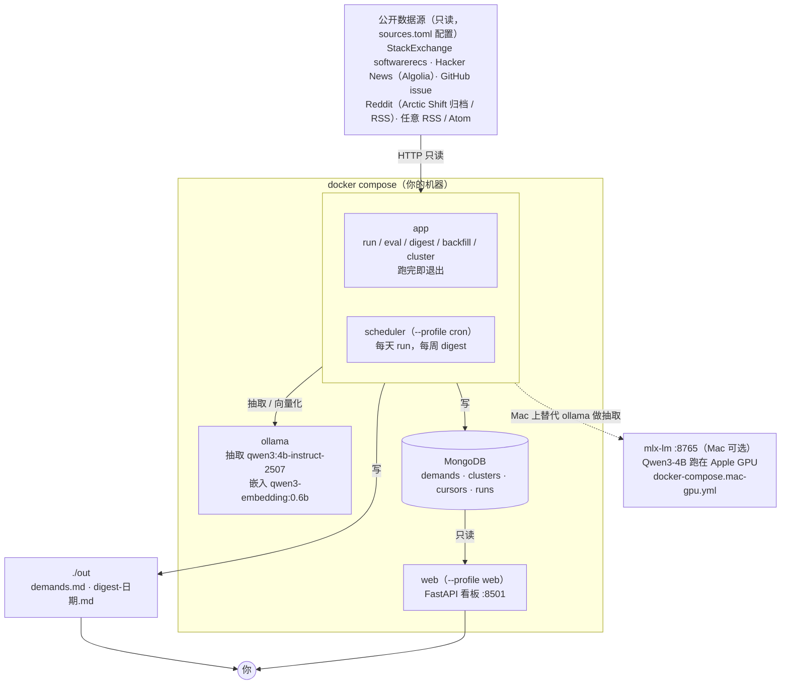
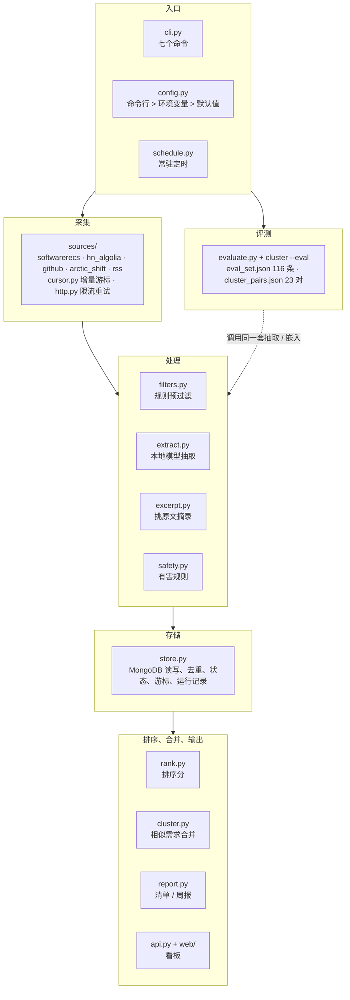
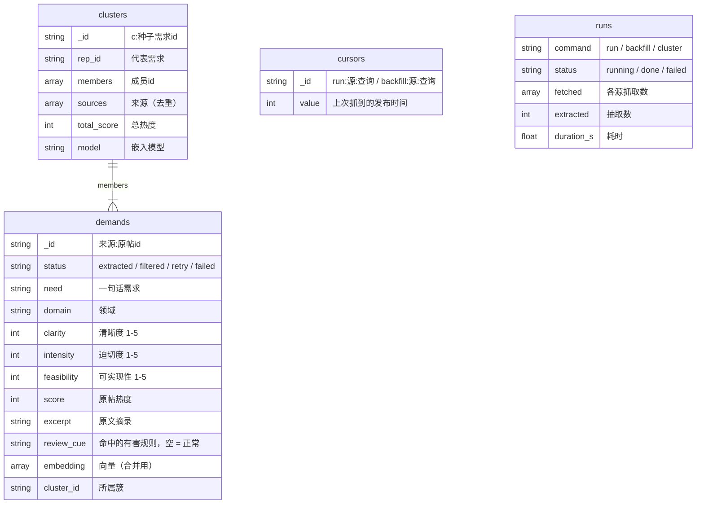

# 需求雷达：系统架构

更新：2026-10-20。图用 Mermaid 写，GitHub 上直接显示成图；改代码时顺手改这里。

## 一、部署架构

所有东西都在你自己的机器上跑。对外只有一种连接：读各平台的公开接口。

| 组件 | 什么时候在跑 | 说明 |
|---|---|---|
| app | 每次 `docker compose run --rm app <命令>` | 跑完一轮就退出；入口脚本先等 ollama、按命令拉需要的模型 |
| scheduler | `--profile cron` 时常驻 | 和 app 同一份代码，自己 sleep 到点，不靠系统 cron |
| web | `--profile web` 时常驻 | 只读库、不调模型；排序和合并逻辑与清单共用 |
| ollama | 默认常驻 | 模型都在本地，不需要 API key |
| mlx-lm | Mac 上可选 | Docker 拿不到 Apple GPU，所以模型在宿主机原生跑；它没有嵌入接口，合并仍走 ollama |
| MongoDB | 常驻 | 数据卷 `mongo-data`，删容器不丢数据 |

## 二、一轮 run 的处理流水线

几个设计取舍：

- **游标在整批处理完才落库**：中途崩溃就不记，下次重抓同一批，已处理的被去重挡住，不丢也不重复。
- **有害判断用规则不用模型**：小模型要么漏判要么把正常工具也判成有害，实测见 `demand_radar/safety.py` 顶部。
- **排序分读取时计算、不入库**：调权重不用重新抽取。
- **合并只看进清单的需求**：待人工确认的不参与合并。

## 三、代码模块

| 命令 | 做什么 | 要模型吗 |
|---|---|---|
| `run` | 抓取 → 过滤 → 抽取 → 存库 → 出清单（`--cluster` 顺手合并） | 抽取模型 |
| `backfill` | 按页往回拉一个源的历史，可中断续跑 | 抽取模型 |
| `digest` | 汇总最近 N 天，出周报 | 不要 |
| `cluster` | 向量化 + 合并相似需求，重写清单；`--eval` 在标注对上评测 | 嵌入模型 |
| `eval` | 在 116 条标注样本上评测抽取质量 | 抽取模型 |
| `schedule` | 常驻，每天 run、每周 digest | 抽取模型 |
| `serve` | Web 看板 | 不要 |

## 四、数据存储

MongoDB 一个库 `demand_radar`，四个集合：

## 五、相关文档

| 文档 | 内容 |
|---|---|
| [`tech-plan.md`](tech-plan.md) | 技术路线、每个版本的验收标准 |
| [`model-selection.md`](model-selection.md) | 模型选型和实测数字 |
| [`arctic-shift.md`](arctic-shift.md) | Reddit 数据源调研与条款 |
| [`research/`](research/) | 专题调研报告 |
